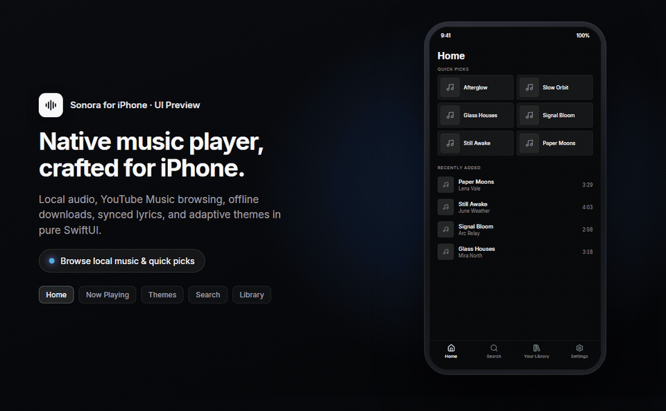
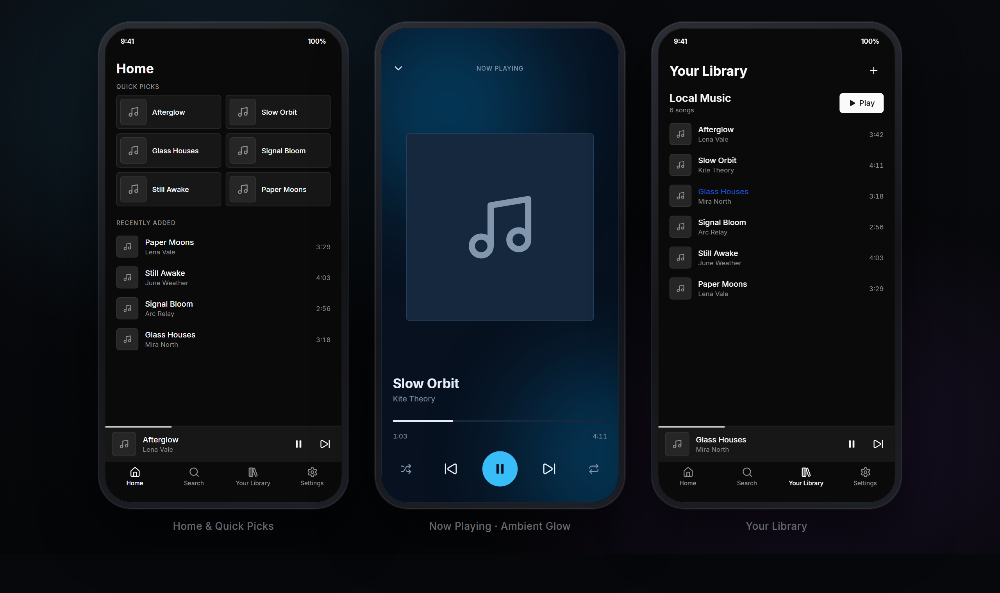
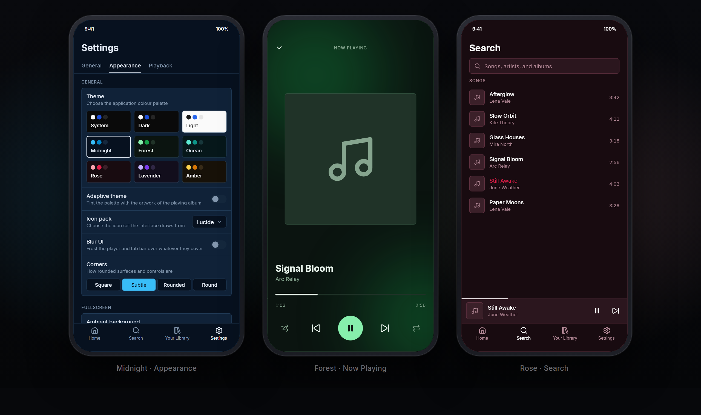

<div align="center">


<h1>Sonora for iPhone</h1>

<p align="center">
  <a href="#features">Features</a>
  ·
  <a href="#run-it">Run it</a>
  ·
  <a href="#engineering">Engineering</a>
  ·
  <a href="docs/limitations.md">Limitations</a>
  ·
  <a href="#documentation">Docs</a>
</p>


[](COPYING)
\
[](https://github.com/sonorahq/sonora)

### A native SwiftUI music player for iPhone

Local audio playback, YouTube Music browsing, offline downloads, and synced lyrics — built in pure Swift with zero external package dependencies.

</div>

<div align="center">
  <table>
    <tr>
      <td colspan="2">
        
      </td>
    </tr>
    <tr>
      <td width="50%">
        
      </td>
      <td width="50%">
        
      </td>
    </tr>
  </table>
  <sub>
    Rendered from the bundled <a href="preview">interactive browser preview</a> (design mockup, not live SwiftUI runtime capture). Adaptive artwork tinting and 9 built-in palettes are customizable in Settings.
  </sub>
</div>

> [!NOTE]
> **Independent iOS adaptation**
>
> Sonora for iPhone adapts the visual language and product ideas of [Sonora](https://github.com/sonorahq/sonora) (the desktop player built with Rust and GPUI) into a separate native SwiftUI codebase. The desktop Rust runtime is not embedded, and this is not an official release from the upstream Sonora team.

> [!IMPORTANT]
> **Early-stage status & provider scope**
>
> Targets **iOS 17+**. Builds and selected playback flows have been checked on a physical iPhone, while account, region, device, and OS coverage remain limited. The YouTube Music and Deezer integrations use unofficial client endpoints — some tracks require signed-in YouTube stream resolution that is not implemented — Subsonic / Navidrome servers are supported over OpenSubsonic REST, and Apple Music and Spotify remain coming-soon placeholders in Settings. See [scope and limitations](docs/limitations.md).

---

## Features

| Area | Capabilities |
| --- | --- |
| **Local listening** | Import audio from Files, keep a persistent library, and play in the background with system media controls. |
| **YouTube Music** | Account sign-in, Home shelves, search, library collections, artist pages, song radio, and supported playlist/like actions. |
| **Deezer** | Browser or `arl` sign-in, Flow & favorites, search, artist/album/playlist pages, `BF_CBC_STRIPE` stream decryption via CommonCrypto, radio, and offline downloads. |
| **Subsonic / Navidrome** | Connect self-hosted servers via salted MD5 auth to browse Home, search, explore artists/albums/playlists, stream, and download. |
| **Playback controls** | Compact & full-screen players, shuffle/repeat, double-tap & swipe seek feedback, queue reordering, and a queue/lyrics pull handle. |
| **Offline music** | Song and collection downloads with progress, pause/resume, persistent partials, and cancellation that preserves completed songs. |
| **Smart downloads** | Choose 10–500 distinct recent songs and press **Start downloads**; slider adjustments alone do not start transfers. |
| **Synced lyrics** | LRCLIB synced lyrics with YouTube Music fallback, tap-to-seek lines, and manual scroll-following controls. |
| **Appearance** | 9 color palettes, 4 icon packs (`Lucide`, `Iconoir`, `Remix`, `Solar`), typography, corner rounding, artwork tint, and motion preferences. |

---

## Run it

```sh
git clone https://github.com/AndreiKocherzhinskiiA/sonora-ios.git
cd sonora-ios
```

### macOS / Xcode

Requires Xcode with a **Swift 6.2+** toolchain and [XcodeGen](https://github.com/yonaskolb/XcodeGen):

```sh
xcodegen generate
open Sonora.xcodeproj
```

Select your development team and an iPhone or simulator, then build and run. Real hardware is needed for background audio and interruption checks. No provider account is required to try imported local audio.

### Linux / Windows with WSL

After configuring Swift, [xtool](https://github.com/xtool-org/xtool), the Apple SDK, and signing:

```sh
bash scripts/deploy.sh build  # compile only
bash scripts/deploy.sh        # build and install on a connected iPhone
```

The helper copies the checkout into `~/sonora-ios` before compiling. See [building and device setup](docs/building.md) for prerequisites, signing, and the Windows USB device bridge.

### Browser UI preview

```sh
python -m http.server 4173 --directory preview
```

Open `http://localhost:4173` to explore the interactive HTML/CSS/JavaScript design mockup (themes, icon packs, Now Playing ambient glow, and layout tokens). It is a historical design preview rather than the SwiftUI app or a streaming client, and does not reflect every current feature.

---

## Engineering

Built exclusively on Apple system frameworks — **zero external SwiftPM package dependencies**:

| Layer | Technology | Role |
| --- | --- | --- |
| **State** | Swift Observation (`@Observable`) | Shared app, queue, history, and download state |
| **Audio** | `AVFoundation` & `MediaPlayer` | Playback, background audio, interruptions, Lock Screen controls |
| **Account & auth** | `WebKit` & `Keychain` | YouTube Music sign-in flow and persistent session storage |
| **Storage** | Local filesystem & JSON indexes | Library imports, `.partial` buffers, atomic `.m4a` publication |

Key implementation details worth exploring in [the architecture guide](docs/architecture.md):

- **Offline-first resolution** — persistent local/downloaded audio is checked before remote stream resolution.
- **Resumable downloads** — byte ranges are validated, partial progress is preserved across pauses/relaunches, and finished files are published atomically.
- **Explicit smart-download state** — slider configuration, applied limit, and active running state are tracked independently.
- **Conflict-free gestures** — native lists avoid competing hold gestures while Home retains its original card interactions.

---

## Documentation

| Guide | Purpose |
| --- | --- |
| [Building](docs/building.md) | Xcode, xtool, signing, and device setup |
| [Architecture](docs/architecture.md) | State ownership, playback, and persistence |
| [Engineering notes](docs/engineering-notes.md) | Concrete bugs, tradeoffs, and lessons |
| [Limitations](docs/limitations.md) | Implemented scope and remaining work |
| [Privacy](docs/privacy.md) | Local storage, credentials, and external requests |
| [Validation](docs/testing.md) | Build and device checks; coverage limits |
| [Contributing](CONTRIBUTING.md) | Development workflow and issue reports |
| [Changelog](CHANGELOG.md) | User-visible changes |

---

## License and credits

Distributed under **GPL-3.0-or-later**, matching upstream Sonora. See [COPYING](COPYING). Bundled fonts and icon packs retain their own licenses in [THIRD_PARTY.md](THIRD_PARTY.md).

The original product, branding, visual direction, and source references come from [Sonora's contributors](https://github.com/sonorahq/sonora). The native iOS implementation and mobile-specific work are maintained in this repository. Sonora is not affiliated with Google, YouTube, or the other named music services. Music and artwork remain the property of their respective rights holders.
