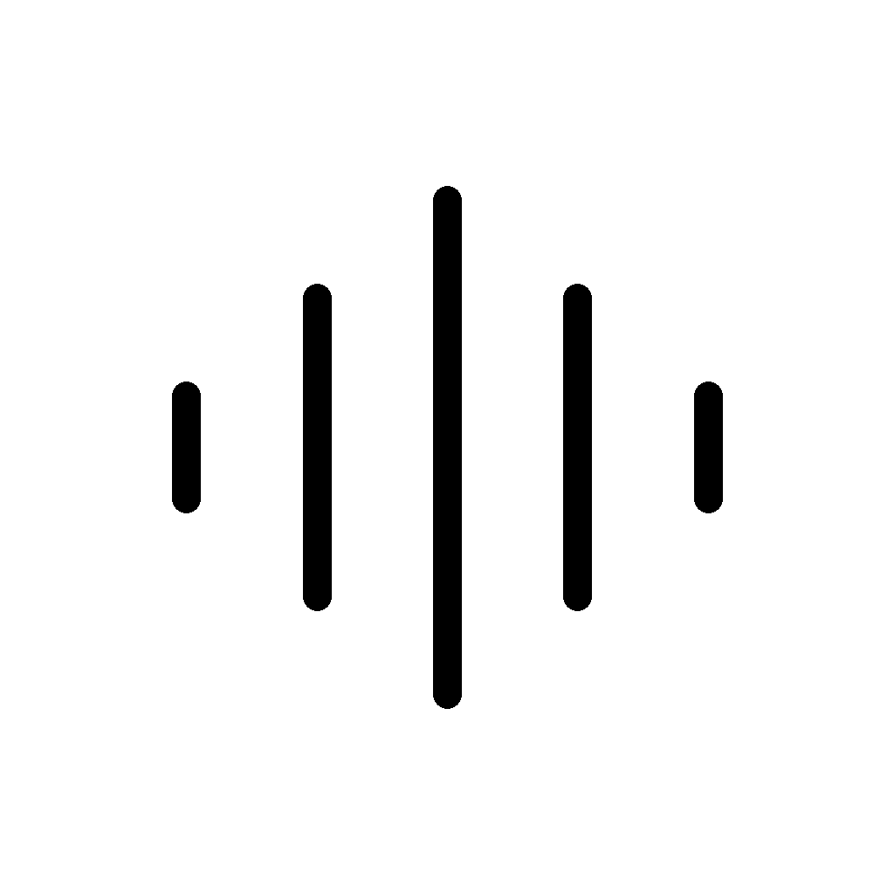

# Sonora for iPhone

A native SwiftUI music player with local files, YouTube Music browsing, offline listening, and synced lyrics.

An independent iOS adaptation of [Sonora](https://github.com/sonorahq/sonora), the desktop music player built with Rust and GPUI. It brings Sonora's visual language and product ideas to iPhone through a separate Swift implementation. The desktop Rust runtime is not embedded in the app. This is not an official release from the upstream Sonora team.

**Status:** early-stage software targeting iOS 17 and later. Builds and selected playback flows have been checked on a physical iPhone; account, region, device, and OS coverage remain limited.

## Features

- **Local listening:** import audio from Files, keep a persistent library, and play in the background with system media controls.
- **YouTube Music:** account sign-in, Home shelves, search, library collections, artist pages, song radio, and supported playlist/like actions.
- **Playback controls:** compact/full-screen players, shuffle/repeat, seek feedback, queue reordering, and a queue/lyrics pull handle.
- **Offline music:** song/collection downloads with progress, pause/resume, persistent partials, and cancellation that preserves completed songs.
- **Smart downloads:** choose 10-500 distinct recent songs and press Start downloads. Slider changes alone do not start transfers.
- **Lyrics:** LRCLIB synced lyrics, YouTube Music fallback, tap-to-seek lines, and manual following controls.
- **Appearance:** themes, icon packs, typography, artwork tint, and motion preferences.

The YouTube integration is unofficial. Some tracks require signed-in stream resolution that is not implemented. Other provider names in Settings are placeholders. See [scope and limitations](docs/limitations.md).

## Run it

```sh
git clone https://github.com/AndreiKocherzhinskiiA/sonora-ios.git
cd sonora-ios
```

### macOS / Xcode

Use Xcode with a Swift 6.2+ toolchain and [XcodeGen](https://github.com/yonaskolb/XcodeGen). From this repository's root:

```sh
xcodegen generate
open Sonora.xcodeproj
```

Select your development team and an iPhone or simulator, then build and run. Real hardware is needed for background audio and interruption checks. No provider account is needed to try imported audio.

### Linux / Windows with WSL

After configuring Swift, [xtool](https://github.com/xtool-org/xtool), the Apple SDK, and signing:

```sh
bash scripts/deploy.sh build  # compile only
bash scripts/deploy.sh        # build and install on a connected iPhone
```

The helper copies the checkout into `~/sonora-ios` before compiling. Read [building and device setup](docs/building.md) for prerequisites, signing, and the Windows device bridge.

### Browser preview

```sh
python -m http.server 4173 --directory preview
```

Open `http://localhost:4173`. This is a historical HTML/CSS/JavaScript design preview, not the SwiftUI app or a streaming client. It does not reflect every current feature.

## Engineering

Swift Observation manages shared state; AVFoundation handles playback; MediaPlayer supplies system controls; WebKit supports sign-in; Keychain stores the session. SwiftPM declares no external package dependencies.

Implementation details worth exploring:

- Persistent audio is checked before remote stream resolution.
- Downloads validate byte ranges and preserve partial work, then publish finished files atomically.
- Smart-download configuration, applied limit, and running state are separate.
- Native lists avoid competing hold gestures; Home retains its original card interactions.

## Documentation

| Guide | Purpose |
| --- | --- |
| [Building](docs/building.md) | Xcode, xtool, signing, device setup |
| [Architecture](docs/architecture.md) | State ownership, playback, persistence |
| [Engineering notes](docs/engineering-notes.md) | Concrete bugs, tradeoffs, and lessons |
| [Limitations](docs/limitations.md) | Implemented scope and remaining work |
| [Privacy](docs/privacy.md) | Local storage, credentials, external requests |
| [Validation](docs/testing.md) | Build and device checks; coverage limits |
| [Contributing](CONTRIBUTING.md) | Development workflow and issue reports |
| [Changelog](CHANGELOG.md) | User-visible changes |

## License and credits

Distributed under **GPL-3.0-or-later**, matching upstream Sonora. See [COPYING](COPYING). Fonts and icons retain their own licenses in [THIRD_PARTY.md](THIRD_PARTY.md).

The original product, branding, visual direction, and source references come from Sonora's contributors. The native iOS implementation and mobile-specific work are maintained in this repository. Sonora is not affiliated with Google, YouTube, or the other named music services. Music and artwork remain the property of their respective rights holders.
