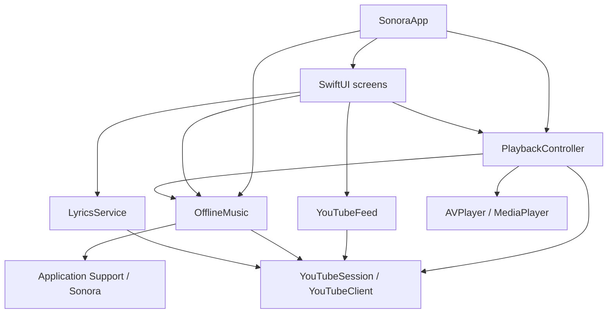

# Architecture

This is a separate SwiftUI application. Desktop Sonora informs its product behavior and visual language; Rust/GPUI, Tokio, SQLite, and the desktop audio engine are not linked into this target.

## Layout

```text
Sonora/
  SonoraApp.swift       service ownership and environment injection
  Models/              track, album, playlist, and provider data
  Services/            playback, downloads, library, history, lyrics, router, toasts
    YouTube/           session, HTTP client, feed, JSON parsers
  Views/               screens and player/song controls
  Theme/               appearance, fonts, tokens, icon selection
  Resources/           fonts and SwiftPM icon PNGs
  Assets.xcassets/     Xcode assets and app icon
Config/                xtool Info.plist input
scripts/               deployment and icon generation
preview/               historical browser mockup
```

## Ownership and execution

`SonoraApp` owns shared `@Observable` services through SwiftUI state and supplies them through the environment. `PlaybackController` is constructed with the same strongly retained `OfflineMusic` store used by the download UI. Startup also connects the local library, YouTube session, and history.

SwiftPM enables default MainActor isolation and Approachable Concurrency. URLSession and AVFoundation provide asynchronous system work. Some JSON/file operations remain synchronous; this is not a claim that all disk-heavy work runs off the main actor.



## Playback

`PlaybackController` owns the queue, current song, repeat/shuffle state, AVPlayer, remote commands, progress updates, and audio interruption handling. It checks `OfflineMusic.localURL(for:)` before resolving a YouTube stream. Downloads match source identity rather than per-entry UUIDs, because a song can appear repeatedly in history or the queue.

Imported/cached audio becomes a file-backed player item. YouTube streaming resolves a provider URL and request headers. Item failures and prolonged buffering become errors rather than indefinite waits.

## Downloads

`OfflineMusic` stores completed metadata in `Downloads/index.json`, pending jobs in `Downloads/pending.json`, partial audio in `.partial` files, and published audio as `.m4a` files. It fetches bounded ranges, validates offsets/lengths, records progress, and atomically publishes finished files. Restore reconciles publication interrupted before a metadata save.

Network availability can suspend/resume work, but background execution is not guaranteed. A cancelled in-flight chunk may be fetched again; committed chunks are retained. Host range support and unchanged formats are prerequisites for resuming.

Smart downloads separate the configured slider limit, explicitly applied limit, and persistent running flag. Start downloads applies the selection. Cancel all stops pending work and refills, removes partials, and preserves completed audio.

## Provider and lyrics

`YouTubeSession` restores cookies from Keychain and exposes the client. Browsing/mutations use the signed-in account; playback resolution uses a guest client. `YouTubeFeed` publishes Home pages progressively and retains library collections. Request-generation checks reject stale refresh results.

`LyricsService` tries LRCLIB, then YouTube Music lyrics. Results are cached in memory. Native scroll phases stop automatic following during manual scrolling on iOS 18+, with an explicit follow control.

## Persistence

| Data | Location |
| --- | --- |
| Imported audio and index | Application Support / Sonora / Media and library.json |
| History | Application Support / Sonora / history.json |
| Offline audio and jobs | Application Support / Sonora / Downloads |
| Appearance/download preferences | UserDefaults |
| YouTube session | Keychain, using a device-only accessibility setting |
| Lyrics cache | Process memory |

Filesystem string paths must be decoded. A URL-encoded path is not interchangeable with a filesystem path, especially under `Application Support`.
